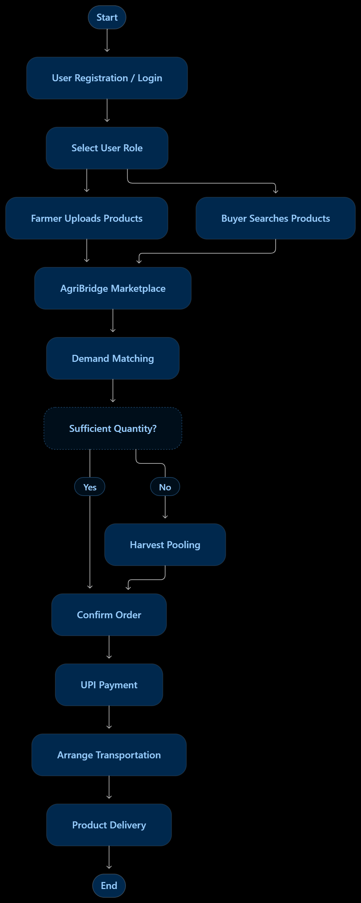

# Smart India Hackathon Workshop
# Date:25.11.2026
## Reference Number:26010324
## Name:Taruthrra Tejja TP

## Problem Title
SIH 26033: Multiple intermediaries reduce farmers earnings and increase consumer prices.

## Problem Creater's Organization
Ministry of Consumer Affairs, Food & Public Distribution

## Theme
Agriculture, FoodTech & Rural Development

## Problem Description
Expected Solution: Create a digital marketplace that:

• Connects farmers/FPOs directly with consumers and bulk buyers.
• Provides logistics support.
• Uses AI for demand forecasting and route optimization.

Benefits:

• Better prices for farmers.
• Lower prices for consumers.
• Reduced supply chain inefficiencies.

## Proposed Solution
1. Detailed explanation of the proposed solution
AgriBridge is a digital marketplace designed to connect farmers, Farmer, consumers, retailers, hotels, supermarkets and bulk buyers directly.
This platform eliminates intermediaries by providing app in which farmers can list their products and buyers can purchase them directly.
My app has a unique feature called Harvest Pooling, in which combines products from multiple farmers into a single large supply. This helps farmers fulfil large orders.

2. How it addresses the problem
The traditional agricultural supply chain includes multiple intermediaries and each intermediary adds additional costs, increasing the price paid by consumers.
MY app solves this problem by creating a direct contact between farmers and consumers.
Farmers can compare buyer offers and select the best offer they can without the need of intermediaries. Small scale farmers can combine their product with other small scale farmer to fulfil bulk orders, while shared transportation reduces individual delivery cost.
Thus, my app reduces unnecessary distribution costs, improves farmer's financials status and helps consumers to buy products at low prices.

4. Innovation and uniqueness of the solution
The main uniqueness of my app is it has Harvest Pooling and Demand Matching features.
Unlike normal agricultural market, which mainly allow farmers to list and sell individual products, my app combines the supply of multiple farmers based on buyer demand.

## Technical Approach
1. Technologies to be used (e.g. programming languages, frameworks, hardware)
my app uses technologies like
HTML, CSS, Python, Javascript, UPI features, django

2. Methodology and process for implementation <b>(Flow Charts/Images/ working prototype)</b>

## Feasibility and Viability
1. Analysis of the feasibility of the idea
my app is technically and economically feasible because it uses existing technologies such as mobile app, django databases, python, UPI, HTML, Javascript, and CSS.
The platform can initially be developed as a web application and later further develop it into an Android and iOS app.

2. Potential challenges and risks
Limited internet in rural areas.
Lack of awareness among many farmers.
Maintaining product quality.
Transportation and storage difficutly.
Unstable price in agricultural.

3. Strategies for overcoming these challenges
Provide a simple and user friendly interface.
Assisted registration through FPOs and local goverment offices.
Checking quality before dispatch.
contract with local logistics office and cold storage gooddown.
Update market prices regularly using reliable market data.

## Impact and Benefits
1. Potential impact on the target audience
Farmers:
Improved access to local and large-scale buyers.
Better selling opportunities and price transparency.
Reduced dependence on multiple intermediaries.
Opportunities for small-scale farmers through collective selling.

Consumers:
Can but product at low prices.
Better product quality.

Retailers and Bulk Buyers:
Direct purchase from farmers and FPOs.
Easier bulk purchasing.
Lower prices for buying 

2. Benefits of the solution (social, economic, environmental, etc.)
Economic - Better earning opportunities for farmers and lowers distribution costs
Social -	Supports small scale farmers and rural communities
Environmental -	Reduces food wastage and unnecessary transportation
Consumer -	reduced price for buying and improved product quality 
Agricultural -	Encourages better harvest

## Research and References
1. e-NAM (National Agriculture Market)
2. Ministry of Agriculture and Farmers Welfare
3. Ministry of Consumer Affairs, Food & Public Distribution
4. FAO (Food and Agriculture Organization)